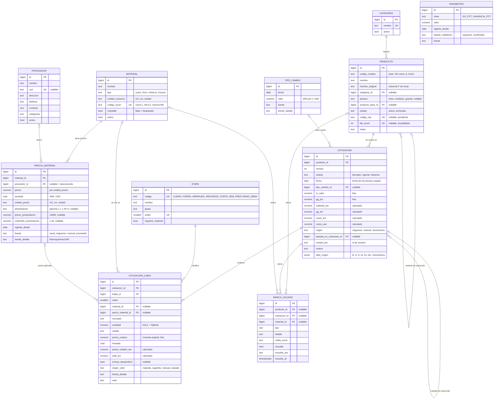

# DER v1 · Casa López · App de costos

> Copiar a `docs/der.md` en el repo `casa-lopez-app`. Es la fuente de la WO 2 ("Implementar el modelo PostgreSQL del DER actual").
> Versión: v1, 2026-10-12. Reemplaza el DER del informe del 11/10 (v0). Estado: **provisional**, autorizado por Robert para la base demo de staging mientras Gerardo responde las preguntas.
> Explicación en simple, ejemplos con números y decisiones abiertas: `wo1-modelo-conceptual.md` (entregable de la WO 1).
> Borrador SQL probado en Postgres 16: `der-borrador.sql`. **No es la migración**: la migración se hace con Alembic en la WO 2.

## 1. Reglas que el esquema tiene que respetar

1. **Plata con `NUMERIC`, nunca `float`.** Montos `NUMERIC(14,4)`, consumos `NUMERIC(10,4)`, dólar `NUMERIC(12,4)`, porcentajes `NUMERIC(6,3)`. En Python, `Decimal`.
2. **Cada precio guarda su moneda y su unidad.** La conversión a pesos la hace el motor con el dólar de la cotización, solo si el precio está en USD.
3. **Lo que tiene historia no se pisa.** `precio_material`, `tipo_cambio`, `parametro` y `cotizacion` solo reciben filas nuevas. Una cotización `vigente` o `historica` no se edita: se crea la versión siguiente.
4. **El motor es el único que calcula.** `subtotal_ars`, `gg_ars`, `costo_ars`, `costo_usd`, `precio_unitario_ars` y `total_ars` los escribe el backend. Ni el front ni un usuario los mandan.
5. **No inventar.** Un dato que no se sabe va `NULL` o como texto original en `dato_origen`, con una `marca_calidad`. Un `0` significa "sabemos que no lleva".
6. **Todo tiene procedencia.** `fuente` y `fuente_detalle` (por ejemplo `Marroquineria1!W5`) en precios, dólar, parámetros y líneas.
7. Nombres en español, `snake_case`, singular. Todas las tablas van en el **schema `costos`** (ver 6.2).

## 2. Qué entra en la primera migración

| Fase 1: primera migración (11 tablas) | Fase 2: cuando haga falta (5 tablas) |
|---|---|
| `categoria`, `producto`, `etapa`, `material`, `proveedor`, `precio_material`, `tipo_cambio`, `parametro`, `cotizacion`, `cotizacion_linea`, `marca_calidad` | `taller`, `orden_fabricacion` (es el "lote"), `precio_venta`, `venta`, `plantilla_linea` |

La fase 2 no se migra hasta que Gerardo responda sobre M.O., talleres y lotes, y Alejandro sobre ventas y ERP. Está definida abajo para que nadie la invente distinto después.

## 3. Diagrama

Todas las tablas llevan además `created_at timestamptz NOT NULL DEFAULT now()`; `producto` lleva también `updated_at`.

## 4. Tablas de la fase 1 (columnas, tipos y restricciones)

### 4.1 `categoria`
| Columna | Tipo | Nulo | Regla |
|---|---|---|---|
| id | bigint identity | no | PK |
| nombre | text | no | UNIQUE. Lista abierta: Cartera, Portafolio, Billetera, Necesaire… |
| activo | boolean | no | default true |

### 4.2 `producto`
| Columna | Tipo | Nulo | Regla |
|---|---|---|---|
| id | bigint identity | no | PK. Es la única identidad estable. |
| codigo_modelo | text | sí | Columna G **leída como texto**. **No es único** (514, 739, 915, 1525, 1729, 2296, 2413, 2493, 2509, 2670 se repiten). Índice común. |
| nombre | text | no | Nombre limpio (sin medidas, fechas ni notas). |
| nombre_original | text | sí | Columna F tal cual, para trazar. |
| categoria_id | bigint | sí | FK `categoria`. Se infiere del nombre; a validar. |
| tamano | text | sí | CHECK chico, mediano, grande. |
| producto_base_id | bigint | sí | FK `producto`. Solo si la base es inequívoca (ver 5.4). CHECK distinto de `id`. |
| estado | text | no | CHECK activo, archivado. Default activo. Lo cambia una persona. |
| codigo_erp | text | sí | UNIQUE. Vacío hasta que Alejandro diga cuál es el código del ERP. |
| fila_excel | integer | sí | UNIQUE. Fila de `Marroquineria1` de la que salió. |
| notas | text | sí | |

### 4.3 `etapa` (datos fijos, se cargan en la migración)
| codigo | nombre | grupo | orden | requiere_material |
|---|---|---|---|---|
| CUERO | Cuero (capa externa) | material exterior | 1 | true |
| FORRO | Forro (capa interna) | material interior | 2 | true |
| HERRAJES | Herrajes, hilo y cemento | accesorios y detalles | 3 | false |
| REFUERZO | Refuerzos (flex, goma EVA) | accesorios y detalles | 4 | true |
| CORTE | Corte | refinamiento | 5 | false |
| REB | Reb (supuesto: rebajado) | refinamiento | 6 | false |
| PREP | Prep (supuesto: preparación) | refinamiento | 7 | false |
| MANO_OBRA | Mano de obra (estimación) | mano de obra | 8 | false |

`codigo` UNIQUE, `orden` UNIQUE. "Reb" y "Prep" no se renombran hasta que Gerardo diga qué son.

### 4.4 `material`
| Columna | Tipo | Nulo | Regla |
|---|---|---|---|
| id | bigint identity | no | PK. Id propio: en el Excel cuero 1 y forro 1 comparten número. |
| nombre | text | no | |
| tipo | text | no | CHECK cuero, forro, refuerzo, insumo. |
| unidad_consumo | text | no | CHECK m2, cm, unidad. En qué se mide el consumo en una línea. |
| codigo_excel | text | sí | UNIQUE. `cuero:1`…`cuero:6`, `forro:1`, `forro:2`, `insumo:W5`, `insumo:W6`, `insumo:W10`. Mapea (etapa, código) del Excel. |
| cotizable | boolean | no | Default true. **false** para lagarto y yacaré mientras su precio esté en otra unidad. |
| activo | boolean | no | Default true. |
| notas | text | sí | |

Sin `proveedor_id` y sin moneda: el proveedor y la moneda viven en `precio_material`.

### 4.5 `proveedor`
| Columna | Tipo | Nulo | Regla |
|---|---|---|---|
| id | bigint identity | no | PK |
| nombre | text | no | |
| cuit | text | sí | UNIQUE (varios NULL permitidos). |
| direccion, telefono, contacto, categorias, notas | text | sí | Mínimo viable. El Excel de proveedores (datos desde 2004) es para después. |
| activo | boolean | no | Default true. |

### 4.6 `precio_material` (la oferta de un proveedor; solo se agregan filas)
| Columna | Tipo | Nulo | Regla |
|---|---|---|---|
| id | bigint identity | no | PK |
| material_id | bigint | no | FK `material` |
| proveedor_id | bigint | sí | FK `proveedor`. NULL = no sabemos a quién se le compra (los cueros del Excel). |
| precio | numeric(14,4) | no | CHECK ≥ 0. Precio de **una** `unidad_precio`. Es el que usa el motor. |
| moneda | char(3) | no | CHECK ARS, USD. |
| unidad_precio | text | no | CHECK m2, cm, unidad. |
| presentacion | text | sí | Cómo se compra: "plancha 1 x 1,40 m". |
| precio_presentacion | numeric(14,4) | sí | Precio de la presentación entera (14000). CHECK: va junto con `presentacion`. |
| contenido_presentacion | numeric(10,4) | sí | Cuántas `unidad_precio` trae (1,40 m²). |
| vigente_desde | date | no | |
| fuente | text | no | CHECK excel_migracion, manual, proveedor. |
| fuente_detalle | text | sí | Celda o documento. |

UNIQUE (`material_id`, `COALESCE(proveedor_id, 0)`, `vigente_desde`). El precio vigente de un material a una fecha es el de `vigente_desde` más reciente que no la supere.

Regla del backend (no de la base): **una línea solo puede usar un precio si `unidad_precio = material.unidad_consumo`**. Así el lagarto (USD por cm) no se puede multiplicar por un consumo en m².

### 4.7 `tipo_cambio`
| Columna | Tipo | Nulo | Regla |
|---|---|---|---|
| id | bigint identity | no | PK |
| fecha | date | no | |
| valor | numeric(12,4) | no | CHECK > 0. Pesos por 1 USD. |
| fuente | text | no | Hoy "manual Excel". Qué dólar es (BNA, MEP, blue) está sin definir. |
| fuente_detalle | text | sí | |

UNIQUE (`fecha`, `fuente`).

### 4.8 `parametro`
| Columna | Tipo | Nulo | Regla |
|---|---|---|---|
| id | bigint identity | no | PK |
| clave | text | no | CHECK GG_PCT, GANANCIA_PCT. Se agregan claves con una migración, no a mano. |
| valor | numeric(6,3) | no | |
| vigente_desde | date | no | |
| estado_validacion | text | no | CHECK supuesto, confirmado. Default supuesto. |
| fuente, fuente_detalle | text | | |

UNIQUE (`clave`, `vigente_desde`). Semilla: GG_PCT 11 y GANANCIA_PCT 0, ambos `supuesto`. La ganancia **no** entra en el costo.

### 4.9 `cotizacion`
| Columna | Tipo | Nulo | Regla |
|---|---|---|---|
| id | bigint identity | no | PK |
| producto_id | bigint | no | FK `producto` |
| version | integer | no | CHECK ≥ 1. UNIQUE (`producto_id`, `version`). |
| estado | text | no | CHECK borrador, vigente, historica. **Índice único parcial: una sola `vigente` por producto.** |
| fecha | date | no | Fecha de los precios y del dólar usados. En la migración: 2026-09-01. |
| tipo_cambio_id | bigint | sí | FK `tipo_cambio` |
| tc_valor | numeric(12,4) | no | Copia del dólar usado (foto). |
| gg_pct | numeric(6,3) | no | Copia del GG usado (foto). |
| subtotal_ars, gg_ars, costo_ars, costo_usd | numeric(14,4) | sí | Los escribe el motor. NULL solo en `borrador`. |
| origen | text | no | CHECK migracion, manual, recotizacion. |
| basada_en_cotizacion_id | bigint | sí | FK `cotizacion`. De qué cotización (de este u otro producto) se copió. |
| creado_por | text | sí | Id del usuario de Better Auth (WO 4). Sin FK por ahora. |
| motivo | text | sí | Por qué se recotizó o se cambió un valor. |
| dato_origen | jsonb | sí | Lo que el Excel trae y todavía no entendemos: columnas B, D, E (`fecha_costeo_excel`), AI original, AJ/AK, comentarios de celda. |

Transiciones: `borrador → vigente` (la vigente anterior pasa a `historica` en la misma transacción) y nada más. Una `vigente` o `historica` no se edita.

### 4.10 `cotizacion_linea`
| Columna | Tipo | Nulo | Regla |
|---|---|---|---|
| id | bigint identity | no | PK |
| cotizacion_id | bigint | no | FK `cotizacion`, índice. |
| etapa_id | bigint | no | FK `etapa` |
| orden | smallint | no | Default 1. Permite dos líneas de cuero (productos bicolores). |
| material_id | bigint | sí | Obligatorio si `etapa.requiere_material` (lo valida el backend). |
| precio_material_id | bigint | sí | FK. CHECK: si hay precio, hay material. NULL en precios congelados del Excel (fila 242). |
| concepto | text | no | "Cuero", "Herrajes + hilo y cemento (global)", "Estimación de la planilla". |
| cantidad | numeric(10,4) | sí | CHECK ≥ 0. Consumo en `unidad`, o 1 para montos globales. **NULL = dato faltante.** |
| unidad | text | no | m2, cm, unidad, global, producto. |
| precio_unitario | numeric(14,4) | no | Foto del precio en su moneda original. |
| moneda | char(3) | no | CHECK ARS, USD. |
| precio_unitario_ars | numeric(14,4) | no | Calculado: × `tc_valor` si es USD. |
| total_ars | numeric(14,4) | no | Calculado: `precio_unitario_ars × cantidad` (0 si cantidad es NULL, con marca). |
| incluye_desperdicio | boolean | sí | true en consumos migrados de cuero y forro (supuesto). NULL = no se sabe. |
| origen_valor | text | no | CHECK migrado, sugerido, manual, copiado. |
| fuente_detalle | text | sí | Celda de origen: `Marroquineria1!J22`. |
| nota | text | sí | |

Regla de migración: **un 0 en el Excel no crea línea** ("no lleva"). Una celda vacía donde debería haber dato crea la línea con `cantidad` NULL y una marca.

### 4.11 `marca_calidad`
| Columna | Tipo | Nulo | Regla |
|---|---|---|---|
| id | bigint identity | no | PK |
| producto_id, cotizacion_id, material_id | bigint | sí | FKs. CHECK: al menos uno cargado. |
| tipo | text | no | error_origen, costo_tipeado, dolar_congelado, sin_consumo_cuero, costeo_parcial, unidad_incompatible, modelo_repetido, variante_sin_base, base_ambigua, costeo_varias_unidades, multi_cuero, costo_alternativo_sin_rotulo, sin_tipo_cuero. Texto libre con lista sugerida, para no migrar cada tipo nuevo. |
| detalle | text | sí | |
| celda_excel | text | sí | |
| resuelta | boolean | no | Default false. |
| resuelta_por | text | sí | |
| resuelta_at | timestamptz | sí | |

## 5. Reglas de la migración del Excel (para el importador)

1. **Fecha de precios = 2026-09-01** (Rouez y Acropol, 2026-09-03). La columna E va a `dato_origen.fecha_costeo_excel`, no a `cotizacion.fecha`, porque las fórmulas usan los precios de hoy, no los de esa fecha.
2. **Precios del Excel en su moneda real:** cueros 1, 2 y 6 y potro en USD por m²; grano largo **ARS 34.040** por m² (tipeado, marca `dolar_congelado` sobre el material); tela, flex, goma y cartón en ARS por m² con el valor tipeado (4053, 10000, 5857, 12250) y la plancha como presentación. Lagarto y yacaré: USD 26 y 3 por **cm**, `cotizable = false`.
3. **Herrajes:** una línea HERRAJES sin material, cantidad 1, unidad `global`, precio en USD (columna R).
4. **Corte, reb, prep y M.O.:** una línea cada una, cantidad 1, unidad `producto`, ARS.
5. **Filas con error** (tipo de cuero vacío, lagarto, yacaré, X42): producto creado, cotización en `borrador` con lo que se sabe y marca. No tienen costo vigente.
6. **Precios congelados** (fila 242): líneas con el precio tipeado en ARS, `precio_material_id` NULL, marca `dolar_congelado`.
7. **Variantes "/n"**: `producto_base_id` solo si existe exactamente un producto con ese código base; si hay dos (514) o ninguno (1/65, 149/2, 500/1, 553/1, 620/1), queda NULL con marca.
8. Descartar filas 348 a 350; deduplicar la tabla de Necesaires (374 a 381) contra el bloque central; ignorar AJ373 en adelante.
9. Recalcular siempre el costo con el motor; AI del Excel queda en `dato_origen.ai_excel`.

## 6. Notas para la WO 2 y la WO 4

### 6.1 Plataforma
La WO 2 dice Heroku, pero el proyecto está en **Railway** (proyecto Casa López, environment `staging`). Corregirlo en el work order. Solo staging; producción no se toca sin autorización.

### 6.2 Schema `costos` y Better Auth
Better Auth (WO 4) crea sus propias tablas (`user`, `session`, `account`, `verification`) en la misma base. Para que Alembic no las borre ni las pise:
- Las tablas de la app van en el schema `costos` (`MetaData(schema="costos")`) y la tabla de versiones de Alembic también (`version_table_schema="costos"`).
- Alembic solo mira el schema `costos` (`include_schemas=True` + filtro `include_name`).
- Better Auth queda en `public` y lo maneja su propia CLI.
- `cotizacion.creado_por` guarda el id de usuario de Better Auth como texto; la FK se agrega cuando la WO 4 esté hecha.

### 6.3 Tipos en SQLAlchemy
`Numeric(14, 4, asdecimal=True)` para plata; `BigInteger` + `Identity()` para ids; `JSONB` para `dato_origen`; los CHECK como `CheckConstraint`; el índice parcial con `Index(..., unique=True, postgresql_where=text("estado = 'vigente'"))`.

## 7. Fase 2 (definida, no se migra todavía)

| Tabla | Columnas | Por qué espera |
|---|---|---|
| `taller` | id, nombre, tipo (interno, externo, sin_definir), contacto, activo, notas | Falta saber si los nombres de B y D son talleres. |
| `orden_fabricacion` (= lote) | id, producto_id, cotizacion_id (costo esperado), taller_id, cantidad, precio_pedido_unitario, precio_pagado_unitario, moneda, fecha_envio, fecha_recepcion, estado, nota | Falta saber cómo se encarga un lote y qué cobra el taller. Separa lo que **pidió** el taller de lo que **se pagó** (comentario AE53: "pidió $1.000, pagamos $750"). |
| `precio_venta` | id, producto_id, precio, moneda, canal, incluye_iva, vigente_desde | Lo decide Alejandro, afuera del Excel. |
| `venta` | id, producto_id, orden_fabricacion_id (nullable), fecha (`sold_at`), cantidad, precio_unitario, ref_erp | Depende del ERP de Alejandro. |
| `plantilla_linea` | id, categoria_id, tamano, etapa_id, material_id, cantidad_sugerida, monto_sugerido_ars | Son sugerencias para productos nuevos (medianas por categoría y tamaño). Necesitan el consenso de Gerardo. |

La "receta" de un producto existente **no** necesita tabla: son las cantidades de su cotización vigente. Recotizar copia esas cantidades y actualiza precios y dólar.

## 8. Supuestos que el esquema toma (cambiarlos es barato)

| Supuesto | Si Gerardo dice otra cosa |
|---|---|
| El código de modelo no identifica al producto. | Se agrega un UNIQUE o se llena `codigo_erp`. |
| Los consumos migrados incluyen desperdicio. | Columnas nuevas `cantidad_neta` y factor de desperdicio por material. |
| Herrajes es un monto global en USD. | Líneas HERRAJES con material (el esquema ya lo permite). |
| La M.O. de la planilla es una estimación. | No cambia el esquema; cambia la fase 2. |
| GG es un % sobre todo el subtotal. | Nueva clave en `parametro` y cambio en el motor. |
| Los precios de compra no discriminan IVA. | Columna `incluye_iva` en `precio_material`. |
| El costo es por unidad de producto. | Columna `unidades_por_costeo` en `cotizacion` para los "costo x 5 unidades". |
