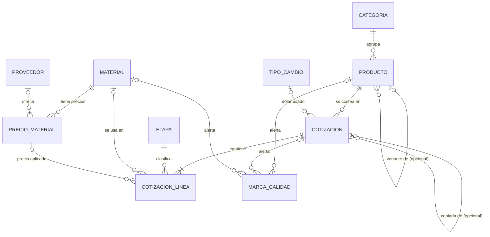

# WO 1 · Modelo conceptual de productos, materiales y proveedores

> Casa López · 2026-10-12 · Entregable de la Work Order 1 ("Diseñar el modelo conceptual de productos, materiales y proveedores").
> Estado: **listo para revisar con Robert**. Lo marcado como pregunta espera a Gerardo (reunión del 13/10) o a Alejandro.
> Archivos que acompañan: `der.md` (especificación técnica para `docs/` del repo, fuente de la WO 2) y `der-borrador.sql` (esquema de prueba que corrí en Postgres 16).

**Cómo leer este documento.** Cada afirmación lleva una de tres etiquetas:
- **Evidencia:** está en el Excel (con la celda) o lo dijo alguien en una reunión.
- **Propuesta:** es una decisión de diseño nuestra, justificada.
- **Pregunta:** no lo sabemos; no se inventa, y se dice qué cambia según la respuesta.

---

## 1. Veredicto

El DER del 11/10 (v0) **está bien en lo central** y se mantiene: catálogo (qué es el producto), precios con fecha (cuánto valen las cosas) y cotizaciones congeladas con líneas por etapa (cuánto costó). Lo probé: con este modelo la fila 22 da **$43.024,27 (USD 27,85)** y con dólar 1.700 da **$44.744,77 (USD 26,32)**, igual que el Excel; la fila 85 da **$201.003,24**, también igual.

Le hice **13 ajustes** para que cumpla todo lo que pide la WO 1 (unidades de compra y de consumo, procedencia, faltantes, lotes) y para que no imponga reglas que todavía no sabemos. Ninguno lo rehace. Además separé lo que entra en la primera migración (**11 tablas**) de lo que espera (**5 tablas**).

Para la WO 2 **no falta nada bloqueante**: todo lo que Gerardo puede cambiar se resuelve agregando una columna o una restricción, no rehaciendo tablas. El paso a paso está en la sección 11.

---

## 2. Qué cambió respecto del DER v0, uno por uno

| # | Cambio | Por qué, en simple |
|---|---|---|
| 1 | **Saqué `material.proveedor_id`** y la flecha "provee habitualmente". | El proveedor se conecta al material solo a través de sus precios. Si el flex se lo compramos a Rouez y mañana también a otro, son dos precios del mismo material, no dos materiales. Tenerlo en los dos lados era duplicar y podían contradecirse. |
| 2 | **Saqué `material.moneda_origen`.** La moneda vive solo en el precio. | El grano largo es un cuero "en dólares", pero en el Excel su precio es $34.040 fijo en pesos (H11). Si la moneda está en el material, el dato miente. En el precio, cada número dice en qué moneda está. |
| 3 | **Tres unidades separadas:** `material.unidad_consumo` (cómo se gasta), `precio_material.unidad_precio` (en qué está el precio) y `presentacion` (cómo se compra). | El flex se compra en plancha de 1 × 1,40 m a $14.000 (V5) y se gasta por m². El motor usa $10.000 por m² (W5, tipeado a mano). Guardamos los dos números: el de la plancha para el futuro y el tipeado para igualar al Excel. Regla: solo se puede usar un precio si su unidad es la del consumo; eso bloquea el lagarto (USD por **cm**) contra un consumo en m². |
| 4 | **Procedencia en todo:** `fuente` y `fuente_detalle` en precios, dólar, parámetros y líneas (por ejemplo `Marroquineria1!W5`). | La WO pide registrar procedencia y evidencia. Así cualquiera sabe de dónde salió cada número sin preguntarle a Gerardo. |
| 5 | **Tabla nueva `parametro`** (GG y ganancia, con fecha y estado "supuesto" o "confirmado"). | El v0 decía "GG y margen son parámetros con fecha" pero no tenía dónde guardarlos. Hoy: GG 11 (G16) y ganancia 0 (G17), los dos como supuesto. |
| 6 | **`codigo_modelo` en texto y NO único.** Saqué el UNIQUE (modelo, variante). | El modelo 514 aparece en la fila 31 (yacaré) y en la 32 (estándar); el 915 en la 47 (estándar) y la 48 (carpincho). No sabemos si son el mismo producto en otro cuero o productos distintos. Si ponemos UNIQUE, el importador se rompe o nos obliga a inventar una regla. La identidad es el `id`; `fila_excel` es único para trazar; `codigo_erp` queda vacío y único hasta que Alejandro diga cuál es. Acá coincido con la otra IA. |
| 7 | **`producto_base_id` solo si la base es una sola.** | De las 16 filas "/n" (351 a 366): 514/1 y 514/2 tienen **dos** bases posibles (filas 31 y 32); 1/65, 149/2, 500/1, 553/1 y 620/1 **no tienen** base; 2538/1, /2 y /3 parecen piezas de un juego de escritorio, no variantes. Se guarda el código tal cual y una marca, sin adivinar. |
| 8 | **Saqué `es_kit` y `unidades_por_costeo`** de producto. | Hay evidencia de kits y de "costo x 5 unidades" (nombres de las filas 202, 258, 298, 310), pero no sabemos cómo los cuenta Gerardo. Agregar las columnas sería inventar la regla. Mientras tanto, marca `costeo_varias_unidades`. |
| 9 | **La receta del producto son las líneas de su cotización vigente.** `plantilla_linea` pasa a fase 2. | En el v0, `plantilla_linea` era por categoría, pero lo decidido es "el consumo actual es el estándar del producto". Eso ya está en las líneas: recotizar copia las cantidades y actualiza precios y dólar. Las sugerencias por categoría (medianas) son para productos nuevos y necesitan el ok de Gerardo. |
| 10 | **Faltante no es lo mismo que cero.** `cantidad` NULL = no sabemos; sin línea = no lleva. | El Alhajero (fila 38) tiene el cuero vacío y su costo sale bajo sin avisar. No es "no lleva cuero": es un dato que falta. Un forro en 0 (49 productos) sí es "no lleva". |
| 11 | **La fecha de la cotización migrada es 01/09/2026**, y la columna E va como `fecha_costeo_excel` en `dato_origen`. | La fila 47 dice 07/02/2023 en E, pero su costo se calcula con el dólar y los precios de 01/09/2026. Si ponemos 2023 como fecha de la cotización, el historial mentiría. |
| 12 | **`basada_en_cotizacion_id`:** de qué cotización se copió una nueva. | Gerardo cotiza copiando un producto parecido ("parecido 103" en la fila 351, "como 1660 pero barra ancha"). Guardarlo deja trazado de dónde salió cada número. |
| 13 | **Mano de obra en tres números:** estimación de la planilla (línea M.O.), lo que **pidió** el taller y lo que **se pagó** (estas dos en `orden_fabricacion`, fase 2). | El comentario de la celda AE53 (2017) dice "Sanchez $1.000 pidió, pagamos $750". Son tres cosas distintas y el v0 juntaba las dos últimas. |

También: las etapas "Reb" y "Prep" quedan con ese nombre (y "supuesto: rebajado / preparación" al lado) hasta que Gerardo diga qué son; y todas las tablas van en un schema propio, `costos`, para que no choquen con las de Better Auth (WO 4).

### 2.1 Lo que dijo la otra IA: qué tomé y qué no

| Sugerencia | Qué hice |
|---|---|
| `producto.id` como clave interna, independiente del modelo | Ya estaba. Se mantiene. |
| No imponer UNIQUE (modelo, variante) | **Tomado** (cambio 6), con los casos 514 y 915 como evidencia. |
| Separar proveedor de sus precios; revisar `material.proveedor_id` | **Tomado** (cambio 1). `precio_material` es la oferta del proveedor. |
| Distinguir unidad de compra, de precio y de consumo | **Tomado** (cambio 3). |
| Moneda original en cada precio | Ya estaba en el precio; **saqué la del material** para que no haya dos (cambio 2). |
| Trazabilidad de cada precio o consumo | **Tomado con columnas** (cambio 4), no con una tabla genérica de "evidencias": sería más complejo y nadie la necesita hoy. |
| Separar estimación, cotización del taller y costo pagado | **Tomado** (cambio 13). |
| Cotizaciones que guardan precios y dólar sin pisar | Ya estaba (foto en la cotización y en cada línea). |
| Documentar confirmado, propuesta y pendiente | Es este documento (secciones 8 y 9). |
| No sobreingenierizar | **Tomado:** 11 tablas ahora, 5 después (sección 10). |

No descarté ninguna sugerencia: todas estaban justificadas. La única diferencia es de forma (punto de trazabilidad).

---

## 3. Diagrama (DER v1)

Solo las tablas de la primera migración. Las de fase 2 están en `der.md`, sección 7.

`PARAMETRO` no tiene flechas: la cotización **copia** el GG vigente (foto) en vez de apuntarlo, para que un cambio de GG no altere cotizaciones viejas.

---

## 4. Diccionario de atributos (en simple)

Tipos exactos y restricciones: `der.md`, sección 4. Acá, qué significa cada cosa.

### Catálogo: qué existe

**`categoria`**: el tipo de producto. `nombre` (Cartera, Portafolio, Billetera, Necesaire…). Lista abierta, inferida de los nombres; a validar.

**`producto`**: cada artículo que se fabrica.
- `id`: número interno; la única identidad estable.
- `codigo_modelo`: columna G tal cual, como texto ("6", "514/1"). Se puede repetir.
- `nombre` y `nombre_original`: el nombre limpio y la columna F sin tocar ("Cartera Peter CH.  Jenny" con sus espacios).
- `categoria_id`, `tamano` (chico, mediano, grande): inferidos del nombre ("Ch.", "Gr"); pueden quedar vacíos.
- `producto_base_id`: si es variante de otro, cuál (solo cuando no hay duda).
- `estado`: activo o archivado. Lo decide una persona.
- `codigo_erp`: el código del sistema de Alejandro. Vacío hasta que lo confirme.
- `fila_excel`: de qué fila de la hoja salió (la columna A es un índice correlativo, no el número de fila: la fila 22 tiene A = 1).

**`etapa`**: los 8 pasos del costo en el orden del Excel: Cuero, Forro, Herrajes, Refuerzo (flex y goma), Corte, Reb, Prep, Mano de obra. `requiere_material` dice si la línea tiene que apuntar a un material.

**`material`**: cada cosa que se compra.
- `tipo`: cuero, forro, refuerzo o insumo.
- `unidad_consumo`: en qué se mide lo que gasta un producto (m² para cuero, forro, flex y goma).
- `codigo_excel`: cómo se llamaba en el Excel ("cuero:1", "forro:2", "insumo:W5"), porque en el Excel cuero 1 y forro 1 comparten número.
- `cotizable`: falso para lagarto y yacaré mientras su precio esté en otra unidad.

**`proveedor`**: a quién se le compra. Nombre, CUIT, dirección, teléfono, contacto, categorías, activo. Hoy hay dos con evidencia: Rouez (flex) y Acropol (goma EVA), según S5 y S6.

### Precios: cuánto valen las cosas, a una fecha

**`precio_material`**: una oferta: "este material, de este proveedor, cuesta esto desde esta fecha".
- `precio` + `moneda` + `unidad_precio`: el precio de **una** unidad (USD 24 por m²; $10.000 por m²).
- `presentacion`, `precio_presentacion`, `contenido_presentacion`: cómo se compra ("plancha 1 × 1,40 m", $14.000, 1,40 m²).
- `vigente_desde`: desde cuándo vale. Un precio nuevo es una fila nueva; el viejo queda.
- `fuente`, `fuente_detalle`: de dónde salió (Excel, celda W5).
- `proveedor_id` vacío = no sabemos a quién se le compra (pasa con todos los cueros).

**`tipo_cambio`**: cuántos pesos vale un dólar en una fecha y de dónde se tomó. Hoy: 1.545, "manual Excel", G15.

**`parametro`**: valores generales con fecha: GG 11 % y ganancia 0 %. `estado_validacion` dice si es supuesto o está confirmado.

### Lo que pasó: cotizaciones

**`cotizacion`**: la foto del costo de un producto en un día.
- `version`: 1, 2, 3… por producto. `estado`: borrador, vigente (una sola por producto) o histórica.
- `fecha`: fecha de los precios usados.
- `tc_valor`, `gg_pct`: el dólar y el GG que se usaron, copiados.
- `subtotal_ars`, `gg_ars`, `costo_ars`, `costo_usd`: los calcula el motor; nadie los escribe.
- `origen`: migración, manual o recotización. `basada_en_cotizacion_id`: de qué cotización se copió.
- `creado_por`, `motivo`: quién y por qué.
- `dato_origen`: lo que el Excel trae y todavía no entendemos (columnas B, D, E, el costo USD original de AI, AJ/AK, comentarios de celda).

**`cotizacion_linea`**: cada renglón del costo.
- `etapa_id`, `orden`: a qué etapa pertenece; `orden` permite dos líneas de cuero en un producto bicolor.
- `material_id`, `precio_material_id`: qué material y qué precio se usó (vacío en herrajes, corte, reb, prep y M.O.).
- `concepto`: el texto que se muestra ("Herrajes + hilo y cemento (global)").
- `cantidad` + `unidad`: el consumo (0,25 m²) o 1 para montos globales. Vacío = falta el dato.
- `precio_unitario` + `moneda`: el precio como estaba en su moneda (USD 24).
- `precio_unitario_ars`, `total_ars`: lo mismo en pesos con el dólar de la cotización, y el total.
- `incluye_desperdicio`: si el consumo trae el desperdicio adentro (supuesto: sí en cuero y forro migrados).
- `origen_valor`: migrado, sugerido, manual o copiado. `fuente_detalle`: la celda.

**`marca_calidad`**: una alerta sobre un dato dudoso de un producto, una cotización o un material ("sin consumo de cuero", "dólar congelado", "base ambigua"). Se marca resuelta cuando alguien la revisa.

---

## 5. Relaciones y cardinalidades

| Relación | Cardinalidad | Se lee | Evidencia o motivo |
|---|---|---|---|
| categoria → producto | 1 a 0..N | Una categoría agrupa muchos productos; un producto puede no tener categoría todavía. | Las categorías se infieren del nombre; algunas filas no tienen nombre (F94). |
| producto → producto (base) | 0..1 a 0..N | Un producto puede ser variante de uno; un producto puede tener muchas variantes. | Filas 351 a 366. |
| producto → cotizacion | 1 a 0..N | Un producto tiene muchas versiones de costo; una sola vigente. | Pedido de la meeting: historial y variación. |
| cotizacion → cotizacion (copiada de) | 0..1 a 0..N | Una cotización puede salir de otra. | "parecido 103", "como 1660…". |
| tipo_cambio → cotizacion | 0..1 a 0..N | Una cotización usa un dólar; un dólar sirve a muchas. | G15 único para toda la hoja. |
| cotizacion → cotizacion_linea | 1 a 1..N | Toda cotización tiene al menos una línea. | Cada fila del Excel tiene al menos M.O. |
| etapa → cotizacion_linea | 1 a 0..N | Cada línea es de una etapa. | Colores y columnas del Excel. |
| material → cotizacion_linea | 0..1 a 0..N | Una línea de cuero, forro o refuerzo apunta a un material; herrajes, corte, reb, prep y M.O. no. | Columnas H, M, T, X. |
| precio_material → cotizacion_linea | 0..1 a 0..N | Una línea usa un precio; vacío si el precio era tipeado (fila 242). | K242 = 33.600. |
| material → precio_material | 1 a 0..N | Un material tiene muchos precios en el tiempo y de distintos proveedores. | Pedido de la meeting: historial de precios. |
| proveedor → precio_material | 0..1 a 0..N | Un proveedor ofrece muchos precios; un precio puede no tener proveedor conocido. | S5, S6 tienen proveedor; los cueros no. |
| producto / cotizacion / material → marca_calidad | 0..1 a 0..N | Una marca apunta al menos a uno de los tres. | 11 filas con error, 14 tipeadas, H11, etc. |

---

## 6. Casos reales del Excel con números

### 6.1 Fila 22 · Portafolio Simple Ch. (modelo 6): el caso normal

| Etapa | Material | Cantidad | Precio original | En pesos (dólar 1.545) | Total |
|---|---|---|---|---|---|
| Cuero | Estándar | 0,25 m² | USD 24 / m² | 37.080 | 9.270,00 |
| Forro | Tela forrería | 0,20 m² | ARS 4.053 / m² | 4.053 | 810,60 |
| Herrajes | (global) | 1 | USD 4 | 6.180 | 6.180,00 |
| Refuerzo | Flex | 0,45 m² | ARS 10.000 / m² | 10.000 | 4.500,00 |
| Corte | | 1 | ARS 3.000 | 3.000 | 3.000,00 |
| Reb | | 1 | ARS 1.500 | 1.500 | 1.500,00 |
| Prep | | 1 | ARS 1.500 | 1.500 | 1.500,00 |
| Mano de obra | (estimación) | 1 | ARS 12.000 | 12.000 | 12.000,00 |
| **Subtotal** | | | | | **38.760,60** |
| GG 11 % | | | | | 4.263,67 |
| **Costo** | | | | | **43.024,27 ARS = USD 27,85** |

Goma EVA está en 0 (X22): **no se crea línea**. Excel AH22 = 43.024,266. ✔ (probado en Postgres).

**Recotización con dólar 1.700 (versión 2):** solo suben las líneas en USD: cuero 10.200 y herrajes 6.800. Subtotal 40.310,60 → **costo 44.744,77 ARS = USD 26,32**. La versión 1 queda como histórica con su 43.024,27. Probado.

### 6.2 Fila 85 · Cartera Bugatti portafolio (modelo 1729): forro en dólares

Carpincho 0,9 m² × USD 80 = 111.240; **potro** 0,8 m² × USD 19 = 23.484; herrajes USD 8 = 12.360; flex 0,8 m² = 8.000; corte 3.000 + reb 1.500 + prep 1.500; M.O. 20.000. Subtotal 181.084 → **costo 201.003,24 ARS = USD 130,10**. Igual a AH85. ✔ Muestra que el forro puede estar en USD (potro) o en pesos (tela), y por eso la moneda va en el precio.

Con dólar 1.700: 217.382,40 ARS. Acá el costo en USD baja menos (130,10 → 127,87) que en la fila 22, porque esta cartera tiene más parte en dólares.

### 6.3 Filas 31 y 32 · modelo 514 dos veces

| Fila | Nombre | Cuero | Resultado en el modelo |
|---|---|---|---|
| 31 | Cartera Peter CH. | Yacaré overo, 0,9 | Producto A. Cotización en **borrador** (yacaré no cotizable), marcas `unidad_incompatible` y `modelo_repetido`. Sin costo vigente. |
| 32 | Cartera Peter CH.  Jenny | Estándar, 0,5 | Producto B. Cotización vigente, costo 55.598,62. Marca `modelo_repetido`. |

Son dos productos con el mismo `codigo_modelo`. Las variantes 514/1 ("Cartera Peter Kent GR. Alison") y 514/2 no se enganchan a ninguno: marca `base_ambigua`. **Pregunta:** ¿514 es el modelo y el cuero lo que cambia?

### 6.4 Filas 47 y 48 · Billetera Dólar (modelo 915): mismo modelo, otro cuero y costeo parcial

| Fila | Cuero | Herrajes | Corte / reb / prep | M.O. | Costo Excel |
|---|---|---|---|---|---|
| 47 | Estándar 0,18 | USD 1 | 3.000 / 1.500 / 1.500 | 7.000 | 23.913,44 |
| 48 | Carpincho 0,18 | 0 | 0 / 0 / 0 | 18.000 | 45.035,19 |

La 48 no tiene corte, reb, prep ni herrajes y la M.O. es más del doble. El modelo no lo "arregla": migra lo que hay (sin esas líneas) con la marca `costeo_parcial`. Las dos tienen B = "Fabian, Adrián" y E = 07/02/2023, que van a `dato_origen`.

### 6.5 Fila 38 · Alhajero (modelo 739): dato faltante

J38 está vacío (consumo de cuero) con tipo de cuero 1 cargado. El Excel da 23.287,56 sin avisar. En el modelo: línea de cuero con `cantidad` **vacía**, total 0 para igualar al Excel, y marca `sin_consumo_cuero`. Nadie confunde "falta el dato" con "no lleva cuero".

### 6.6 Fila 242 · Cartera Hermes ch al corte: precios congelados con otro dólar

K242 = 33.600 (= 24 × 1.400) y P242 = 26.600 (= 19 × 1.400), pegados como valores. Las líneas guardan esos pesos tal cual, sin apuntar a un precio de la tabla, con marca `dolar_congelado` y costo 74.401 como en el Excel. Si se recotiza, toma los precios de hoy y la diferencia queda a la vista.

### 6.7 Fila 351 · "Tarjetero doble… (parecido 103)", modelo 103/1

Variante con base única (103 existe una vez): `producto_base_id` apunta a ella. D = "Fabian" y E = 23/07/2024 van a `dato_origen`. El costo USD de AI (6,33) está tipeado; la cuenta da 8,85. El modelo guarda el 6,33 como dato de comparación y usa el recalculado.

### 6.8 Flex: unidad de compra, de precio y de consumo

| Qué | Valor | Dónde vive |
|---|---|---|
| Presentación de compra | plancha 1 × 1,40 m = 1,40 m² | `precio_material.presentacion`, `contenido_presentacion` |
| Precio de la plancha | $14.000 (V5, Rouez, 03/09/2026) | `precio_presentacion` |
| Precio por m² que usa el motor | $10.000 (W5, tipeado) | `precio` + `unidad_precio = m2` |
| Consumo de un producto | 0,45 m² (T22) | `cotizacion_linea.cantidad` |

Para la goma EVA, 8.200 / 1,40 = 5.857,14, pero W6 tiene 5.857 tipeado; se guarda el tipeado para igualar al Excel.

---

## 7. Qué representa y qué NO representa cada monto y cada unidad

| Campo | Representa | NO representa |
|---|---|---|
| `precio_material.precio` | El precio de **una** unidad del material (1 m²), en su moneda, desde una fecha, según una fuente. | El precio de la plancha; un precio con desperdicio; un precio con o sin IVA confirmado (**pregunta**). |
| `precio_presentacion` | Lo que cuesta la plancha o rollo entero. | Lo que usa el motor (en la paridad se usa el precio por m² tipeado). |
| `cotizacion_linea.cantidad` (cuero, forro) | Consumo **bruto** por unidad de producto, en m², tal como lo cargó Gerardo. Supuesto: con el desperdicio adentro. | La superficie neta de las piezas; un consumo medido (no sabemos si es medido o "a ojo"). |
| `cantidad` (refuerzo) | m² de flex o goma por unidad de producto. | — |
| Línea HERRAJES | Un monto global en USD por producto que incluye herrajes, hilo y cemento (S11: "Hilo, cemento va en HERRAJES usd 2"). | El detalle de cada herraje; si lo compra Casa López o el taller (**pregunta**). |
| Líneas CORTE, REB, PREP | Un monto fijo en pesos por producto. | Quién lo cobra ni qué tarea es exactamente (**pregunta**); no se actualiza con el dólar. |
| Línea MANO_OBRA | La estimación en pesos que figura en la planilla (AE). | Lo que cobró o se le pagó al taller; horas × tarifa (no sabemos cómo sale). |
| `subtotal_ars` | Suma de las líneas en pesos. | — |
| `gg_ars` | 11 % sobre **todo** el subtotal (incluye M.O.). Supuesto: gastos generales. | IVA (sería 21 % o 10,5 %); un margen. |
| `costo_ars` | Costo de fabricación de **una** unidad, con el dólar y los precios de la fecha de la cotización. | Precio de venta; margen; impuestos de venta; costo real pagado. |
| `costo_usd` | `costo_ars` dividido el dólar de la cotización, como referencia. | Lo que se pagó en dólares: la mayor parte del costo está en pesos. |
| `tc_valor` | Pesos por dólar usados en esa cotización. Fuente: manual. | Un tipo de dólar definido (BNA, MEP, blue: **pregunta**). |
| `parametro` GANANCIA_PCT | Hoy 0: el Excel no la usa. | Algo que entre en el costo. |
| Fase 2: `precio_pedido_unitario` / `precio_pagado_unitario` | Lo que pidió el taller por unidad / lo que se le pagó. | La estimación de la planilla. |
| Unidad "producto" | Un producto terminado. | Un kit ni "costo x 5 unidades" (**pregunta**; esas filas van marcadas). |

---

## 8. Decisiones sobre versionado, lotes y faltantes

**Versionado (propuesta).** Una cotización guardada no se edita: se crea la versión siguiente y la anterior pasa a histórica en el mismo paso. Una sola vigente por producto (lo garantiza un índice único de la base, probado). Cada cotización copia el dólar, el GG y el precio de cada línea. Los precios, el dólar y los parámetros también son "solo agregar filas". *Evidencia:* la meeting pide historial y variación; el Excel guarda el costo anterior a mano (AJ/AK de los necesaires). *Pregunta abierta:* qué dispara una recotización (cambio de dólar, de un precio, cada lote).

**Lotes (propuesta).** Un lote es una orden de fabricación: producto, cotización con la que se esperaba el costo, taller, cantidad, lo que pidió y lo que se pagó. No hace falta una tabla "lote" aparte. **Fase 2**: no entra en la primera migración porque no sabemos cómo se encarga un lote ni qué incluye lo que cobra el taller.

**Faltantes (propuesta).**
- Vacío donde debería haber dato → `NULL` + marca (fila 38).
- 0 → "no lleva", no se crea línea (forro 0 en 49 productos).
- Fila con error (tipo de cuero vacío en 82, 86, 94, 98 y 256; lagarto; yacaré; X42) → producto creado, cotización en borrador, sin costo vigente, con marca.
- Texto que no entendemos (B, D, E, AJ/AK, comentarios) → se guarda tal cual en `dato_origen`, no se convierte en campos.

---

## 9. Decisiones abiertas

**Bloquea WO 2** = hay que esperar la respuesta para crear el esquema. Ninguna lo bloquea: todas se resuelven con datos o con una columna nueva.

| # | Tema | Evidencia | Propuesta (hoy) | Pregunta y para quién | Qué cambia según la respuesta |
|---|---|---|---|---|---|
| 1 | ¿Qué identifica a un producto? | 10 modelos repetidos (514, 915…); G como texto en 351:366. | `id` propio; `codigo_modelo` no único; `codigo_erp` vacío. | ¿El modelo es el código del ERP? ¿Por qué se repite? *Gerardo y Alejandro* | Llenar `codigo_erp` o agregar un UNIQUE. |
| 2 | ¿Qué significa "/n"? | 514/1 con dos bases; 5 sin base; 2538/1-3 juego. | Enlazar solo si la base es una. | ¿Color, tamaño, pieza de un juego? *Gerardo* | Completar `producto_base_id`; si son piezas, es tema de kits (#13). |
| 3 | Unidad del precio del cuero | "U$S" en F6, consumo en m² (J). | USD por m². | ¿m² o pie²? *Gerardo* | Cambian los precios, no el esquema. |
| 4 | Desperdicio | I3 "30 %" sin uso; 11 de 12 consumos de 3 decimales son × 1,2. | `incluye_desperdicio = true`, no se aplica nada encima. | ¿Ya está en el consumo? ¿Igual para todos los cueros? *Gerardo* | Columnas de consumo neto y factor por material. |
| 5 | Lagarto y yacaré | "usd 26 x cm", "usd 3 x cm" (texto). | No cotizables. | ¿Unidad real? ¿Se siguen usando? *Gerardo* | Habilitar el material con su unidad. |
| 6 | Grano largo | H11 = 34.040 tipeado (23 × 1.480). | Precio en ARS fijo. | ¿Cuál es el precio bueno? *Gerardo* | Un precio nuevo con fecha. |
| 7 | Herrajes | R en USD global; S11 "hilo, cemento… usd 2"; 29 valores con +10 % encadenado. | Línea global en USD. | ¿Qué incluye? ¿Los compra Casa López o el taller? *Gerardo* | Líneas con material de herraje (ya permitido). |
| 8 | Corte, reb, prep | 3.000 / 1.500 / 1.500 casi siempre. | Montos ARS por producto. | ¿Qué son y quién los cobra? ¿El taller los incluye? *Gerardo* | Si el taller los incluye, se estarían contando dos veces: cambia el motor y la fase 2. |
| 9 | Mano de obra | 36 valores; AE53 "pidió 1.000, pagamos 750". | Estimación en la cotización; pedido y pagado en la orden. | ¿La M.O. de la planilla es del artesano? ¿Cómo cobra el taller? *Gerardo; confirmar con Robert* | Columnas de la orden (fase 2). |
| 10 | GG 11 % | G16 = 11, se aplica sobre todo el subtotal. | Parámetro "supuesto". | ¿Qué es y sobre qué se aplica? *Gerardo* | Nueva clave de parámetro o cambio del motor. |
| 11 | Ganancia 27 % | G17 = 0, sin uso. | Parámetro 0, fuera del costo. | ¿Recargo sobre costo o margen sobre precio? *Gerardo y Alejandro* | Afecta `precio_venta` (fase 2). |
| 12 | **IVA en precios de compra** *(nueva)* | Ningún precio dice si incluye IVA. | No se asume nada. | ¿USD 24 el m² y $14.000 la plancha son con o sin IVA? *Gerardo* | Columna `incluye_iva` en precios; puede cambiar todos los costos. |
| 13 | Kits y "costo x N unidades" | Filas 202, 258, 298, 310. | Marca, costo tal cual. | ¿Cómo los costea? *Gerardo* | Columna `unidades_por_costeo` o productos compuestos. |
| 14 | Columnas B, D, E | B/D nombres (Fabián, Lucio…), E 115 fechas. | Texto en `dato_origen`. | ¿Quién fabricó o cotizó? ¿E es la fecha de costeo? *Gerardo* | Tabla `taller` y vínculo; fecha a un campo propio. |
| 15 | Proveedor de los cueros | No figura. | `proveedor_id` vacío. | ¿Qué curtiembre? *Gerardo* | Solo datos. |
| 16 | Tipo de dólar | G15 = 1.545 manual. | `fuente = manual Excel`. | ¿BNA, MEP, blue, comprador o vendedor? *Gerardo* | Solo datos y, después, el scraping. |
| 17 | Plancha o rollo *(nueva)* | "Flex 1 x 1,40 mts" sin decir cuál. | Texto libre "rollo/plancha". | ¿Cómo se compra? *Gerardo* | Solo el texto. |

Las preguntas nuevas (#12 y #17) y la de "/n" como pieza de juego no están en `preguntas-gerardo-robert.md`; pedí que las sumen.

---

## 10. Qué entra en la primera migración

| Entra ahora (11) | Por qué alcanza | Espera (5) | Qué la destraba |
|---|---|---|---|
| categoria, producto, etapa, material, proveedor, precio_material, tipo_cambio, parametro, cotizacion, cotizacion_linea, marca_calidad | Con esto se importa el Excel entero, se iguala el costo, se recotiza con otro dólar y se ve el historial. Es lo que piden la WO 2 y el plan de la semana 1. | taller, orden_fabricacion, precio_venta, venta, plantilla_linea | Respuestas de Gerardo sobre M.O., talleres y lotes; de Alejandro sobre ventas y ERP; consenso sobre sugerencias. |

---

## 11. Validación y próximos pasos

**Lo que ya validé**
- El esquema compila en Postgres 16 (`der-borrador.sql`).
- Reproduce las filas 22 y 85 al centavo, y la recotización de la 22 con dólar 1.700.
- La base rechaza una segunda cotización vigente y una versión repetida, y acepta dos productos con el mismo modelo.

**Lo que falta para cerrar la WO 1:** revisarlo con Robert (criterio 3 de la WO). Sugiero mandarle este archivo y marcar la WO como lista para revisión; las preguntas van con él a Gerardo mañana.

**Para arrancar la WO 2 (no hace falta esperar a Gerardo)**
1. Pedir que corrijan "Heroku" por "Railway" en la WO 2.
2. Revisar lo que hizo Codex con la conexión: que lea `DATABASE_URL` del entorno, que no la imprima en logs, que use `Decimal` y que la URL tenga el formato que pide SQLAlchemy (`postgresql+psycopg://…`). Ojo: la `DATABASE_URL` de Railway apunta a una dirección interna que solo funciona dentro de Railway; desde tu compu hace falta la pública (`DATABASE_PUBLIC_URL`) o correr el comando con `railway run`.
3. Copiar `der.md` a `docs/der.md` del repo en una rama nueva.
4. Pasarle a Codex el pedido de abajo.
5. Revisar la migración que genera contra `der.md` (las tablas, los CHECK, el índice de "una vigente").
6. Aplicarla en staging y comprobar que el backend lee y escribe (un endpoint de salud que haga `SELECT 1` y uno que liste las etapas cargadas).
7. Documentar en `docs/` cómo se configuró, sin credenciales.

**Pedido para Codex (copiar y pegar)**

> Leé `docs/der.md` y `AGENTS.md`. Implementá en el backend FastAPI, con SQLAlchemy 2 y Alembic, **solo las 11 tablas de la fase 1** de `docs/der.md`, en el schema `costos`, con los tipos, CHECK, UNIQUE e índices exactos de la sección 4 (incluido el índice único parcial de cotización vigente). Usá `Numeric` con `Decimal` para plata, nunca float. Configurá Alembic para que solo mire el schema `costos` y guarde su tabla de versiones ahí (sección 6.2), porque Better Auth va a tener sus tablas en `public`. Hacé dos migraciones: 1) el esquema, 2) los datos semilla de etapas, materiales, proveedores Rouez y Acropol, precios, dólar 1545 y parámetros (están en `docs/der-borrador.sql`, sección "Datos semilla"). No rediseñes el DER: si te falta un detalle, elegí lo más simple y anotalo en `docs/decisiones-wo2.md`. No hagas push ni deploy, y no leas ni muestres credenciales. Al final mostrame el SQL que genera `alembic upgrade head --sql`.

(Para ese pedido, copiá también `der-borrador.sql` a `docs/`.)
